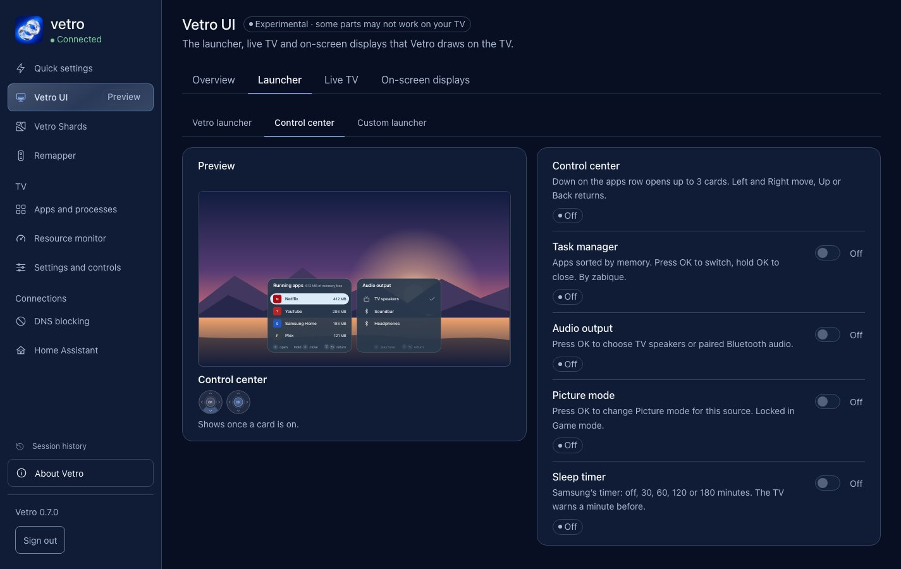

<p align="center"></p>

# Vetro for Tizen 4

A fork of [Vetro](https://github.com/andrearicci93/vetro) for Samsung's 2018 Kant-M2 TVs. Manage installed apps, privacy settings and remote shortcuts from a browser, with an optional lightweight launcher and a root daemon that can start automatically with the TV.

This fork is based on Vetro **0.7.0**. The 0.5.0 Tizen 4 port was tested on **Samsung QE49Q6FNA, Tizen 4, firmware T-KTM2DEUC-1400.2**. The 0.7.0 port was tested on **Samsung UE65NU7100, firmware T-KTM2LDEUC-1400.2**, using the optional standalone runtime ([validation](docs/VALIDATION.md)). Other Tizen 4 models and firmware versions have not been validated. For newer TVs, start with the [upstream compatibility reports](https://github.com/andrearicci93/vetro#compatibility), including the Q60B startup findings and community model reports. Upstream currently has no root method for Tizen 10; this fork’s Kant-M2 USB route does not add support for it.

[Installation](app/docs/INSTALLATION.md) · [Root persistence](kant-m2-root/README.md) · [Updating](app/docs/UPDATING.md) · [Development](docs/DEVELOPMENT.md) · [Security](SECURITY.md)

## Features

- **Browser dashboard:** installed apps, processes, memory and storage, with diagnostic exports.
- **Launcher:** a minimal dock with apps and inputs and an optional Control center, built for the older .NET runtime on Tizen 4.
- **Vetro UI:** one dashboard page for what Vetro draws on the TV, including its own volume bar and number pad.
- **Privacy and app management:** reversible switches for supported services and settings, plus app startup controls.
- **Remote shortcuts:** app launches and key mappings, with optional MQTT and Home Assistant integration.
- **Vetro Shards (plugins), experimental:** community plugins from a signed catalog or a file.
- **Automatic root-daemon startup:** an optional TV boot hook; a host-side supervisor is available for reverse-shell sessions.

Privileged features need an existing root context. Installing the Vetro package does not itself root the TV. Review each setting before applying it; a service switch can also remove the feature it provides.

<p align="center"></p>

## Compatibility and limits

The Tizen 4 port adds Node 4 compatibility, older registry and filesystem layouts, a `netcoreapp2.0` launcher running through Samsung's `corerun`, and legacy tuner/input actions. The `netcoreapp3.1` launcher build is retained for firmware that provides `dotnet`. The [0.7.0 upgrade notes](docs/UPGRADE-0.7.0.md) list what was carried forward and why.

On the Tizen 4 runtime the launcher keeps its Home-key guard and does not use 0.7.0's compositor Home claim. The Samsung Home tile launches Home through the owner's native route, which needs two requests on a cold start; expect a delay of a few seconds. Netflix and YouTube tiles open the native apps, so YouTube keeps its signed-in account. These launcher behaviours were tested on the UE65NU7100 with the standalone runtime; the boot-hook route below has not been re-tested with 0.7.0. HbbTV is a separate, optional setting and does not need to be disabled to install or run Vetro.

The optional TV tuner needs .NET 3.1 and is not available on the tested TVs' .NET 2 runtime. The 0.7.0 early firmware (Quick Boot) hook declines to install while the standalone root owns the vendor boot script.

The boot hook has been observed starting the root daemon after a cold boot without the USB stick on the QE49Q6FNA. This is a result for that device and firmware, not a guarantee for other sets. Memory figures and compatibility reports in inherited upstream documents refer to their stated hardware; they are not performance claims for this port.

## Installation

The supported route for the tested Kant-M2 TVs is:

1. Obtain a root shell using the [Kant-M2 USB root project](https://github.com/GiuseppeFiorillo/samsung-tv-usb-root-kant-m2).
2. Build this fork and sign the package with your own Samsung certificates.
3. Install the package from the root shell and open Vetro on the TV.
4. Optionally install the [boot hook](kant-m2-root/README.md) to start the daemon on subsequent boots.

Follow the [complete installation and recovery guide](app/docs/INSTALLATION.md). In-app updates use only this fork’s signed release channel; upstream updates are not accepted. Once 0.7.0 is published there, a TV on 0.5.0-tizen4 can take it as an in-app update; no reinstall is needed. See [updating and publishing releases](app/docs/UPDATING.md). Upstream catalog packages do not include this port. Keep Vetro on a trusted LAN; its dashboard uses HTTP and must not be exposed to the Internet.

The Python and shell host tools are intended for **Linux and macOS**. USB flashing commands differ by host OS and are documented separately. The hardware validation was performed using macOS; Linux host execution has not yet been independently validated. Host operating system and TV compatibility are separate requirements.

### Optional: standalone runtime

An alternative to the boot hook for UE65NU7100 / T-KTM2LDEUC-1400.2: a root daemon, pairing display, Home-key routing override and USB recovery watcher that start from the vendor boot script, with Developer Mode off. Its boot profile is locked to that firmware build; other models need a reviewed profile. It needs your own original `/opt/etc/parseinfo.sh` as a private input, kept outside the repository:

```sh
VETRO_VENDOR_SCRIPT=/absolute/private/parseinfo.sh npm run build
```

Building never connects to or installs anything on a TV, and this repository has no USB installer for it. See [standalone installation](app/docs/INSTALLATION.md#optional-standalone-runtime), [validation and limits](docs/VALIDATION.md) and the [Home-key override](docs/HOME-KEY-OVERRIDE.md).

## Repository layout

| Directory | Purpose |
| --- | --- |
| `app/` | Dashboard, background service, shared app code and tests |
| `dock/`, `tuner/` | Native launcher and tuner source, resources and desktop tests |
| `chain/` | Tizen 4 package builder, loopback adapter and Node root daemon |
| `kant-m2-root/` | Optional boot hook, host supervisor and offline tests |
| `rooting/` | Upstream integration, runtime payloads, signed update builder and signing dependencies |
| `overlay/`, `lib/`, `profiles/` | Optional standalone runtime: startup, root maintenance, pairing, USB recovery and its firmware profile |
| `native/current/` | Pinned .NET 2 launcher and pairing builds with source fingerprints |
| `tools/` | Standalone builder, source audit and Node 4 check |
| `design/` | Upstream design references |
| `docs/` | Development, upgrade, validation and release documentation |

## Development

Start with [development and checks](docs/DEVELOPMENT.md). The host supervisor and boot installer can be tested without a TV:

```sh
cd kant-m2-root
./check.sh
```

Application checks, from the repository root:

```sh
npm test
npm run test:chain
node rooting/tests/run.cjs
npm run audit
```

[Contributing](CONTRIBUTING.md) · [App architecture](app/README.md) · [Plugin guide](app/docs/plugins.md) · [Changelog](CHANGELOG.md)

## Contributors

Thanks to the people who contributed code and documentation to Vetro (including adapted work whose PR was not merged on GitHub):

- [zerodevb](https://github.com/zerodevb): dashboard and API pairing sign-in ([#9](https://github.com/andrearicci93/vetro/pull/9)).
- [swiezaczek](https://github.com/swiezaczek): a code review and fixes taken into 0.7.0: keyless remote parts no longer listed, payload folders for later updates, pairing refused to sandboxed pages, Shard isolation in Restore the TV, smaller launcher icons, MQTT topics in place, release checks, the YouTube tile fallback, systemd restarts without waiting, the Channel list hold and Task manager fixes ([#218](https://github.com/andrearicci93/vetro/pull/218), [#227](https://github.com/andrearicci93/vetro/pull/227), [#231](https://github.com/andrearicci93/vetro/pull/231), [#241](https://github.com/andrearicci93/vetro/pull/241), [#243](https://github.com/andrearicci93/vetro/pull/243), [#245](https://github.com/andrearicci93/vetro/pull/245), [#249](https://github.com/andrearicci93/vetro/pull/249), [#258](https://github.com/andrearicci93/vetro/pull/258), [#259](https://github.com/andrearicci93/vetro/pull/259), [#268](https://github.com/andrearicci93/vetro/pull/268), [#270](https://github.com/andrearicci93/vetro/pull/270)).
- [chemicalsno](https://github.com/chemicalsno): the idea and first version of the launcher's Home claim, which keeps Samsung's Home from flashing before the launcher ([#184](https://github.com/andrearicci93/vetro/pull/184)).
- [genesai](https://github.com/genesai): SVT Play and other HbbTV-link apps open from Vetro ([#211](https://github.com/andrearicci93/vetro/pull/211)), tried on a Samsung The Frame LS03B.
- [BirikuSistema](https://github.com/BirikuSistema): the input watcher that picks up a Bluetooth remote coming back from standby ([#219](https://github.com/andrearicci93/vetro/issues/219)).
- [Firaenix](https://github.com/Firaenix): CoBA multi-app Home guard, still selection, raw navigation and delayed Home echoes, adapted into the bundled launcher ([#23](https://github.com/andrearicci93/vetro/pull/23), [#24](https://github.com/andrearicci93/vetro/pull/24)).
- [pponce](https://github.com/pponce/vetro): remote input and queued actions are cancelled when the service stops ([#138](https://github.com/andrearicci93/vetro/issues/138)), and the first fix and S95C test for the Samsung Home pill on 2022 and later TVs ([#169](https://github.com/andrearicci93/vetro/pull/169)).
- [zabique](https://github.com/zabique/vetro) (branch `fork/extras`): the ideas and first implementations of Keep removed apps removed, Disable AirPlay, the restart check after a snapshot boot and stopping the HbbTV service app, re-written for Vetro; and the Task manager of the Control center ([#172](https://github.com/andrearicci93/vetro/pull/172)).
- [skjnldsv](https://github.com/skjnldsv): measured that The Frame 2025 (Tizen 9) blocks loopback for apps and proposed reaching the service through the TV's own address ([#122](https://github.com/andrearicci93/vetro/issues/122), [#123](https://github.com/andrearicci93/vetro/pull/123)); adapted for the sign-in. Not tried on a TV yet.
- [Merennor](https://github.com/Merennor): Node 4.4 compatibility for the integration adapter and unsupported-root fallback on Tizen 4 ([#75](https://github.com/andrearicci93/vetro/pull/75)).

- [tomcraft](https://github.com/tomcraft): direct TV-tuner key, and the remote found again after a restart ([#31](https://github.com/andrearicci93/vetro/pull/31), [#32](https://github.com/andrearicci93/vetro/pull/32)).
- [SalustLab](https://github.com/SalustLab): the service on Node 4.4, app-only ([#33](https://github.com/andrearicci93/vetro/pull/33)).
- [domenix](https://github.com/domenix): start at boot when the installer ignores the package flags, S90C compatibility details, app IDs for repeated names ([#27](https://github.com/andrearicci93/vetro/pull/27), [#29](https://github.com/andrearicci93/vetro/pull/29), [#52](https://github.com/andrearicci93/vetro/pull/52)).
- [bertrandom](https://github.com/bertrandom): Tizen Studio links in the installation guide ([#47](https://github.com/andrearicci93/vetro/pull/47)).
- [PatrickSt1991](https://github.com/PatrickSt1991): Apps2Samsung credit ([#21](https://github.com/andrearicci93/vetro/pull/21)).

People who reported problems or shared results from their TVs are credited in the [changelog](CHANGELOG.md).

## Credits & license

Vetro builds on [Chris Ritsen and contributors' Samsung TV root research](https://github.com/chris-ritsen/samsung-tv-root), including runtime detection and compatibility checks adapted from [v0.0.12](https://github.com/chris-ritsen/samsung-tv-root/releases/tag/v0.0.12) under the Unlicense. [Glasshouse](https://github.com/rorygallagher2024/glasshouse) inspired the TV-management concept and dashboard. [TizenBrew, TizenTube and tizen.js](https://github.com/reisxd) informed installation and runtime research; [Samsung's developer documentation](https://developer.samsung.com/smarttv/develop/getting-started/using-sdk/tv-device.html) documents the device workflow. The install-leftovers cleanup is ported from [Apps2Samsung](https://github.com/Apps2Samsung/Apps2Samsung), which upstream recommends for installation on Tizen 6 and newer. See [third-party notices](THIRD_PARTY_NOTICES.md) for provenance and licenses.

Original Vetro code and this fork's additions are [MIT licensed](LICENSE); vendored code retains its own license. See [component licensing](LICENSES.md). Independent, experimental software, provided as is and unaffiliated with Samsung or the projects above.

**Fork provenance.** This repository is based on [andrearicci93/vetro](https://github.com/andrearicci93/vetro) 0.7.0 (sources pinned in `sources.lock.json`). The Tizen 4 port, the `chain/` Node root daemon and the `kant-m2-root/` add-on were written for this fork, and the optional standalone runtime was added with the 0.7.0 port; all are released under the same MIT license. The root agent keeps the upstream `SAMSUNG-TV-ROOT/1` wire protocol. This fork is not maintained by, or affiliated with, the upstream project.
